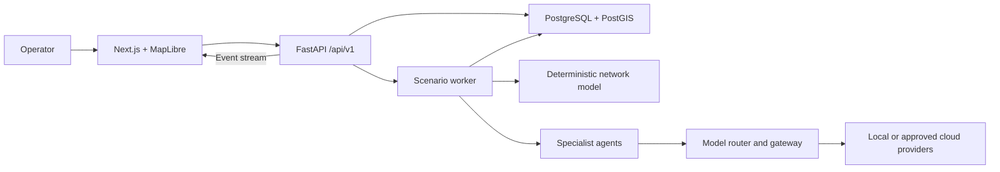

# AgentCity Twin

AgentCity Twin helps city and campus teams see the likely effects of a decision before acting. Its digital twin combines a map and a model of roads, demand, transit, incidents, and sensors. Describe a disruption, compare responses with a do-nothing baseline, and see why one strategy ranked higher. [Product overview](docs/product-overview.md)

## Run with Docker

Install Docker with Compose v2, then run from this directory.

```bash
docker compose up --build --wait
```

Open [the command center](http://localhost:3100), [the public site](http://localhost:3100/welcome), or [the API reference](http://localhost:3100/api-docs). The demo creates an isolated workspace for your browser and requires no credentials. [Create an account](http://localhost:3100/account?mode=register) to administer providers, scoring weights, members, and data sources for your organization.

Compose runs a production Next.js build, FastAPI, leased workers, and PostgreSQL/PostGIS. The migration job creates the schema on first launch. The database remains in its named volume when you run `docker compose down`. See the [Docker guide](docs/docker.md) for changing ports, the project subnet, and the optional model service.

Docker Desktop routes specialist advisories to `prism-ml/bonsai-27b` in LM Studio on the host. The simulation and ranking use the deterministic engine. The Model Lab also supports local Nomic embeddings, streaming, image analysis, and read-only city tools.

## Try the university incident

1. Select **University corridor accident** under **Ask AgentCity**.
2. Select **Analyze scenario** and open **Execution plan** to follow the goal, tools, delegated work, and verification checks.
3. Use **Predicted** and **Recommended** with the timeline to compare network effects.
4. Open **Why did AgentCity choose this?** to see agent findings, scoring, evidence, and uncertainty.
5. View the **Audit trace**, record an operator review when requested, or export JSON and CSV. The app records review decisions. City teams carry out approved actions through their own procedures.

The **Debrecen demo scenarios** picker also includes a downtown tram breakdown, a stadium departure surge, a morning air-quality alert, and an outage affecting essential services. Each preset supplies its own map location, time, duration, severity, population, and constraints. [Offline walkthrough](presentation/index.html)

The provided city telemetry, network capacity, incidents, routes, and forecasts are demonstration inputs. The OpenStreetMap basemap represents geographic features. The simulation is uncalibrated and supports planning and research.

## Local development

Use Python 3.12+ and Node.js 22+.

```powershell
python -m venv .venv
.\.venv\Scripts\python.exe -m pip install -r backend/requirements-dev.txt
npm.cmd --prefix frontend ci
```

Run the backend and frontend in separate terminals.

```powershell
.\scripts\dev.ps1 backend
.\scripts\dev.ps1 frontend
```

On macOS or Linux, activate the virtual environment and run `uvicorn app.main:app --app-dir backend --port 8100 --reload` and `npm --prefix frontend run dev -- --port 3100`. Local development defaults to SQLite. Set `DATABASE_URL` and run `python -m alembic -c backend/alembic.ini upgrade head` before starting the API to use PostgreSQL directly. Use a fresh local database with explicit Alembic migrations by setting `SQLITE_AUTO_SCHEMA=false`.

## Design



- MapLibre renders the local Debrecen basemap and OpenFreeMap styles with switchable overlays. See [Maps](docs/maps.md).
- Configure Ollama, compatible self-hosted endpoints, OpenAI, Azure, Gemini, Anthropic, or a custom REST service. See [Providers](docs/providers.md) and [Environment variables](docs/environment.md).
- Passwords use Argon2id. Session tokens are opaque and stored by hash. Model credentials are server-side environment values or encrypted database values. See [Security](docs/security.md).

## Checks

```powershell
.\.venv\Scripts\python.exe -m pytest
.\.venv\Scripts\python.exe -m ruff check backend scripts
npm.cmd --prefix frontend run lint
npm.cmd --prefix frontend run typecheck
npm.cmd --prefix frontend test
npm.cmd --prefix frontend run e2e
```

Run browser tests against the running demo. [Testing](docs/testing.md) describes browser installation and alternate ports.

## Documentation and contributions

Start with the [documentation index](docs/README.md), [product overview](docs/product-overview.md), or [contribution guide](docs/contribution.md). Review the [implementation matrix](docs/roadmap.md) for operational inputs.

[Workspace screenshot](docs/images/workspace.jpg) · [Recommendation screenshot](docs/images/recommendation.jpg)

Use the [operations guide](docs/operations.md) to connect data feeds, calibrate simulations, configure SSO, and manage delivery and monitoring.
