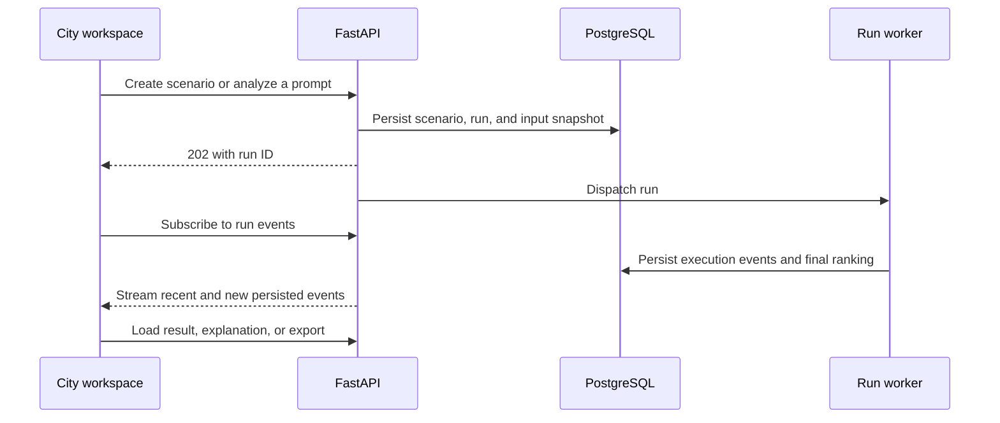

# Architecture

The Next.js application presents the map and workspace, while FastAPI owns scenario validation, permissions, persistence, and the decision workflow. Next.js proxies same-origin API requests and event streams to the internal backend service. MapLibre receives GeoJSON prepared by the backend and renders it against a basemap.

Docker runs an API and a separate PostgreSQL-backed worker service. A worker lease fences competing replicas, and expired leases can retry within a bounded attempt limit. The API streams persisted audit events independently of the worker. SQLite development runs an embedded worker.

